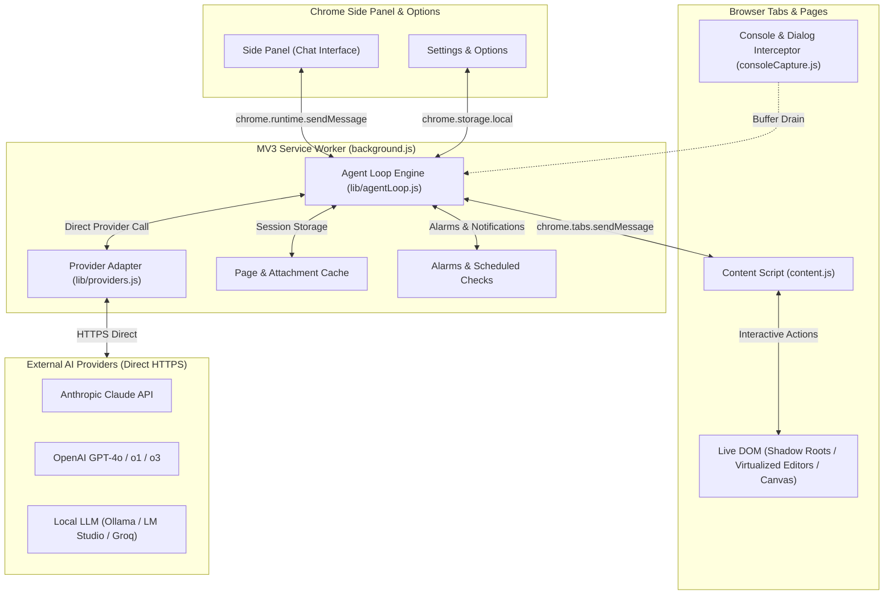

<div align="center">


# Tab Agent

**The autonomous, multi-tab AI browsing agent that runs 100% locally in your browser.**

[](https://chromewebstore.google.com/detail/pglbigeicfjkhfdcamjleoefhmmmciel)
[](https://github.com/VeeraChandu/tab-agent/releases)
[](https://developer.chrome.com/docs/extensions/develop/migrate/what-is-mv3)
[](./LICENSE)
[](#privacy--permissions)

<p align="center">
  <a href="#-quick-start">Quick Start</a> •
  <a href="#-why-tab-agent">Why Tab Agent</a> •
  <a href="#-architecture">Architecture</a> •
  <a href="#-tools--capabilities">Tool Matrix</a> •
  <a href="#-parallel-research--batching">Parallel & Batch</a> •
  <a href="#-agents--slash-commands">Agents & Commands</a> •
  <a href="#-privacy--security">Security & Privacy</a>
</p>

---

</div>

Tab Agent is a Chrome (Manifest V3) extension that turns your browser into an autonomous workspace. Unlike conversational extensions that merely chat about a web page, Tab Agent **reads the live DOM, clicks, types, navigates, manages forms, pierces shadow roots, and hops between multiple tabs** until your task is finished.

> [!IMPORTANT]
> **Zero Proxies. Zero Middleman Servers. 100% Direct.**
> You bring your own API key (Anthropic, OpenAI, or local models like Ollama / LM Studio). All requests go straight from your browser to your chosen provider. Your session data and credentials never touch any intermediary server.

---

## 🌟 Why Tab Agent?

| Feature | What It Does | Why It Matters |
| :--- | :--- | :--- |
| **🪟 True Multi-Tab Parallelism** | Spawns background tabs running isolated concurrent sub-agents (`parallel_investigate`). | Compare 5–10 websites simultaneously in seconds instead of sequential tab switching. |
| **⚡ Shadow DOM & Editor Piercing** | Deep-scans open Shadow Roots, CodeMirror, Monaco, Ace editors, and PDF viewer text layers. | Works flawlessly on Salesforce Lightning, Web Components, and cloud IDEs. |
| **⏰ Background Scheduled Tasks** | Unattended headless alarm checks that visit pages on a timer and post notifications. | Monitor price drops, job listings, server statuses, and breaking changes effortlessly. |
| **👁️ Multimodal & Vision Fallback** | Native screenshots, image filtering, and automatic fallback descriptions for non-vision LLMs. | Lets text-only models understand diagrams, generated images, and complex layouts. |
| **🤝 Human-In-The-Loop** | Seamless pause-and-resume for user feedback (`ask_user`) and risky actions. | Safeguards against accidental purchases, deletions, or irreversible clicks. |
| **🧠 Intelligent Memory & Chunking** | Session-wide page recall cache and dynamic token history compaction. | Eliminates silent truncation on massive pages while preventing token budget bloat. |

---

## 🏗️ Architecture

Tab Agent operates purely inside your browser across three isolated execution boundaries, coordinating via Chrome's native message bus:



### Execution Lifecycles:
1. **`content.js` (Isolated World):** Scans interactive elements, assigns deterministic micro-IDs (`e1`, `e2`, `img3`), and performs synthetic input, keyboard sequences, table extractions, and clipboard operations.
2. **`consoleCapture.js` (Main World):** Intercepts unhandled errors, console warnings, and auto-dismisses native blocking dialogs (`alert`, `confirm`, `prompt`) so the agent never freezes.
3. **`background.js` & `lib/agentLoop.js` (Service Worker):** Houses the cognitive turn-loop, manages sub-agent budgets, and coordinates model interactions without any backend server.

---

## 🚀 Quick Start

### Option A: Install from Chrome Web Store (Recommended)

Get the pre-packaged, verified release directly from the store:

<div align="center">

[](https://chromewebstore.google.com/detail/pglbigeicfjkhfdcamjleoefhmmmciel)

</div>

---

### Option B: Load Unpacked (Development / Source)

1. **Clone the repository:**
   ```bash
   git clone https://github.com/VeeraChandu/tab-agent.git
   cd tab-agent
   ```
2. **Open Extensions:** Navigate to `chrome://extensions` in Google Chrome.
3. **Enable Developer Mode:** Toggle **Developer mode** in the top-right corner.
4. **Load Extension:** Click **Load unpacked** and select the [`src/`](file:///Users/veera/projects/tab-agent/src) directory.
5. **Configure Provider:**
   - Click the Tab Agent icon in your toolbar to open the Side Panel.
   - Click ⚙ **Settings** → **+ Add provider**.
   - Select **Anthropic** or **OpenAI-compatible**, paste your API key, and hit **Fetch models**.
   - *(Optional)* For local models (Ollama / LM Studio), enter your Base URL (e.g., `http://localhost:11434/v1`).
6. **Start Browsing:** Open any tab, describe your task in the Side Panel, and press `Enter`!

---

## 🛠️ Tools & Capabilities

The model has access to a rich set of browser primitives tailored for reliable web automation:

### 🌐 Page Navigation & Tabs
| Tool | Description |
| :--- | :--- |
| `read_page` | Deep DOM scan yielding interactive elements, on-page images, frames, and console/dialog notes. |
| `read_page_chunk` | Fetches remaining chunks of exceptionally large pages without silent truncation. |
| `navigate` | Changes the tab URL; tracks real network failures (DNS, refused connection). |
| `list_tabs` / `read_tabs` | Enumerate open tabs or read multiple background tabs simultaneously. |
| `switch_tab` / `open_tab` / `close_tab` | Move focus between tabs or spawn background tabs without stealing active focus. |
| `list_frames` / `list_media_requests` | Inspect cross-origin iframes and sniff media streams (HLS/DASH/MP4). |

### 🖱️ DOM Actions & Interaction
| Tool | Description |
| :--- | :--- |
| `click` | Click by element ID or viewport coordinates `(x, y)` with modifiers and double/right-click options. |
| `type_text` | Enters text into inputs or contenteditables, with fallback matching by visible label. |
| `fill_form` | Fills complex forms (inputs, checkboxes, radio buttons, sliders) in a single atomic turn. |
| `press_key` | Sends raw keys (Escape, Enter, Tab, Arrow keys) and combos (e.g., `Control+a`). |
| `hover` | Triggers mouseenter to reveal mega-menus, tooltips, and dynamic hover states. |
| `drag` | Drags sliders, sortable lists, or kanban cards via pointer sequences and HTML5 drag events. |
| `upload_file` | Attaches files directly into `<input type="file">` without opening native OS pickers. |
| `copy_to_clipboard` / `read_clipboard` | Synchronizes text with the OS clipboard across tabs and local applications. |

### 🔍 Vision, Data & Extraction
| Tool | Description |
| :--- | :--- |
| `extract_table` | Extracts tabular data into clean, structured JSON rows for analysis or export. |
| `view_image` | Uses the vision model to inspect and describe a specific on-page image or generated artwork. |
| `filter_images` | Evaluates a grid of images against a natural language criterion in minimal LLM calls. |
| `screenshot` | Captures viewport pixels (canvas, CSS backgrounds, full layouts) for vision analysis. |
| `create_file` | Generates downloadable files (CSV, JSON, Markdown, reports) client-side. |
| `recall_page` | Fetches previously viewed pages from session cache without triggering redundant network hits. |

---

## 🔀 Parallel Research & Batching

Tab Agent excels where single-tab assistants fail by providing specialized orchestrators for complex workflows:

### 1. `parallel_investigate` (Multi-Source Comparison)
```
"Compare the pricing and features of Supabase, Firebase, and Convex"
```
- Spawns isolated sub-agents in background tabs concurrently.
- Each branch maintains its own dedicated step budget and cannot derail the main conversation.
- If a branch reaches its budget limit, an inline **▶ Resume** button lets you continue with a fresh budget on the exact same tab.
- Sub-tasks provide real-time progress cards with individual **⏹ Skip remaining, continue** controls.

### 2. `run_batch` (Long-Horizon Tab Automation)
```
"Scrape every row across 10 pages of pagination and extract into a CSV"
```
- Grants an expanded step budget (up to 150 steps) for repetitive, single-tab workloads.
- Avoids repetitive check-ins every few steps while reporting incremental checkpoints.

---

## 🤖 Agents & Slash Commands

Tab Agent cleanly separates one-shot commands from persistent persona instructions:

```
/ = Built-in Commands (One-Shot Actions)
@ = Custom Agent Presets (Sticky Workflows)
```

### Slash Commands (`/`)
- `/clear` — Clears message history for the active session in place.
- `/retry` — Branches and regenerates the previous response.
- `/compact` — Summarizes full chat context into a dense briefing to free up token budget.
- `/model <name>` — Instantly switches models by name (e.g., `/model sonnet` or `/model gpt-4.1`).
- `/stop` — Aborts the active running loop (keyboard shortcut: `Escape`).
- `/help` — Lists all available commands and configured agents.

### Custom Agents (`@`)
Create specialized workflows in **Settings → Agents** with custom system instructions, domain locks, and slug shortcuts:
- `@competitor_tracker` — Monitors feature launches and pricing matrices.
- `@pr_reviewer` — Reviews GitHub pull requests and inspects diffs.
- `@lead_finder` — Extracts verified contact info from directory listings into structured tables.

---

## 🔒 Privacy & Security

> [!NOTE]
> Tab Agent was built from day one around user sovereignty and data safety.

- **Zero Intermediary Servers:** All model queries are dispatched directly from your browser's background service worker to the configured provider endpoint.
- **Client-Side Storage:** Keys, session logs, custom agents, and preferences reside solely in Chrome's `chrome.storage.local`.
- **Sensitive Action Gate:** Destructive actions (buttons labeled "Delete", "Purchase", "Cancel Subscription", "Confirm Order") automatically trigger an explicit confirmation prompt.
- **Category Guardrails:** Sites classified as adult or financial trigger a one-time domain approval prompt before the agent interacts.
- **Trusted Input Fallback (`chrome.debugger`):** For websites with anti-bot or synthetic-event barriers (`event.isTrusted`), optional OS-level event dispatching is available in Settings → Limits (disabled by default).

Read the complete [Privacy Policy](file:///Users/veera/projects/tab-agent/PRIVACY_POLICY.md) and [Permission Justifications](file:///Users/veera/projects/tab-agent/PERMISSION_JUSTIFICATIONS.md).

---

## 💻 Development & Testing

### Project Structure
```
tab-agent/
├── src/                      # The loadable Chrome extension
│   ├── manifest.json         # MV3 Manifest definition
│   ├── background.js         # Service worker coordinator
│   ├── content.js            # DOM interaction & element tagging
│   ├── consoleCapture.js     # MAIN-world error/dialog interceptor
│   ├── sidepanel.html/js/css # Extension chat interface
│   ├── options.html/js/css   # Settings and agent management
│   └── lib/                  # Core modules (agentLoop, providers, tools, caches)
├── test/                     # Unit and integration test suite
├── scripts/                  # Packaging and Chrome Store publish scripts
├── docs/                     # Static GitHub Pages documentation
└── config/                   # ESLint & Jest configurations
```

### Available Scripts

| Command | Action |
| :--- | :--- |
| `npm test` | Runs the test suite via Jest (`jest-environment-jsdom`). |
| `npm run lint` | Lints JavaScript using ESLint flat configuration. |
| `npm run lint:fix` | Automatically formats and fixes linting issues. |
| `npm run build` | Bundles `src/` into a distributable archive in `dist/`. |

---

## 📜 License

This repository's source code is public for transparency, auditability, and personal use, but is **not** open-source under permissive licenses (MIT/Apache). Viewing, local execution, and pull requests are welcome. Redistribution, re-hosting, or commercial republishing without permission is prohibited.

See the complete terms in the [`LICENSE`](./LICENSE) file.
